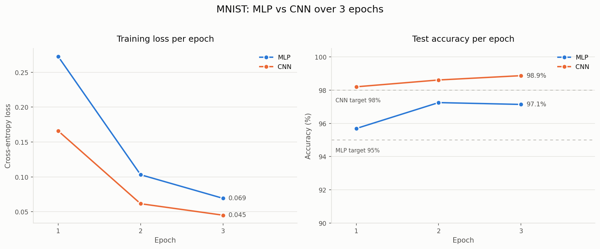

# C1 MNIST 手写数字识别：MLP 与 CNN 对比实验报告

## 1. 实验概述

本实验使用 PyTorch 在 MNIST 手写数字数据集上训练两个模型，并对比它们的性能：

- **MLP（多层感知机）**：把 28×28 的图像展平成 784 维向量，通过两个隐藏层完成分类。
- **CNN（卷积神经网络）**：通过卷积层和池化层保留图像的空间结构，再接入全连接层分类。

实验配置如下：

| 项目 | 配置 |
|---|---|
| 训练集 / 测试集 | 60,000 / 10,000 张 |
| 图像尺寸 | 28×28 灰度图（单通道） |
| Batch Size | 128 |
| 优化器 | Adam，学习率 1e-3 |
| 损失函数 | CrossEntropyLoss（交叉熵） |
| Epoch | 3 |
| 运行设备 | NVIDIA GeForce RTX 5060 Laptop GPU（CUDA） |

最终测试集准确率：

| 模型 | Epoch 1 | Epoch 2 | Epoch 3（最终） | 目标 | 结果 |
|---|---|---|---|---|---|
| MLP | 95.69% | 97.25% | **97.14%** | > 95% | 达标 |
| CNN | 98.20% | 98.61% | **98.87%** | > 98% | 达标 |

训练 Loss 变化：

| 模型 | Epoch 1 | Epoch 2 | Epoch 3 |
|---|---|---|---|
| MLP | 0.2726 | 0.1031 | 0.0693 |
| CNN | 0.1659 | 0.0616 | 0.0451 |



---

## 2. 张量维度流转（Shape 变化）

下面以第一个 batch（128 张图）为例，说明数据在每一层之后的 shape 变化。
其中第一个维度 `128` 是 batch size，表示一次同时送入 128 张图；最后一维的 `10` 表示 10 个数字类别的打分（logits）。

### 2.1 MLP

| 层 | 类型 | 输出 shape | 说明 |
|---|---|---|---|
| 输入 | — | (128, 1, 28, 28) | 128 张单通道 28×28 灰度图 |
| flatten | Flatten | (128, 784) | 把每张图的 28×28 拉直成 784 维向量 |
| fc1 | Linear | (128, 256) | 784 → 256，第一隐藏层 |
| relu1 | ReLU | (128, 256) | 激活函数，形状不变 |
| fc2 | Linear | (128, 128) | 256 → 128，第二隐藏层 |
| relu2 | ReLU | (128, 128) | 激活函数，形状不变 |
| fc3 | Linear | (128, 10) | 128 → 10，输出 10 个类别的分数 |

关键点：`Flatten` 之后，图像被当成 784 个互相独立的数字，像素原本“上下左右相邻”的空间关系在这一步丢失了。

### 2.2 CNN

| 层 | 类型 | 输出 shape | 说明 |
|---|---|---|---|
| 输入 | — | (128, 1, 28, 28) | 128 张单通道 28×28 灰度图 |
| features.0 | Conv2d | (128, 32, 28, 28) | 3×3 卷积 + padding=1，通道 1 → 32，宽高不变 |
| features.1 | BatchNorm2d | (128, 32, 28, 28) | 批归一化，形状不变，稳定训练 |
| features.2 | ReLU | (128, 32, 28, 28) | 激活函数，形状不变 |
| features.3 | MaxPool2d | (128, 32, 14, 14) | 2×2 最大池化，宽高各减半 |
| features.4 | Conv2d | (128, 64, 14, 14) | 3×3 卷积 + padding=1，通道 32 → 64，宽高不变 |
| features.5 | BatchNorm2d | (128, 64, 14, 14) | 批归一化，形状不变 |
| features.6 | ReLU | (128, 64, 14, 14) | 激活函数，形状不变 |
| features.7 | MaxPool2d | (128, 64, 7, 7) | 2×2 最大池化，宽高再次减半 |
| classifier.0 | Flatten | (128, 3136) | 64 × 7 × 7 = 3136，拉直后送入全连接层 |
| classifier.1 | Linear | (128, 128) | 3136 → 128 |
| classifier.2 | ReLU | (128, 128) | 激活函数，形状不变 |
| classifier.3 | Dropout | (128, 128) | 随机丢弃 25% 神经元，防止过拟合，形状不变 |
| classifier.4 | Linear | (128, 10) | 128 → 10，输出 10 个类别的分数 |

关键点：整个卷积阶段宽高从 28 → 14 → 7，通道数从 1 → 32 → 64。
特征图越来越“小”但越来越“厚”，可以理解为网络把图像逐步压缩成更抽象、信息更密集的特征表示。

---

## 3. 训练循环的四个步骤

训练时，我们把 60,000 张训练图分成若干个 batch（每批 128 张），每次拿一个 batch 做一轮参数更新。
对每个 batch，核心是下面四步：

```python
optimizer.zero_grad()            # 1. 清空上一轮的梯度
outputs = model(images)          # 2. 前向传播：算出预测结果
loss = criterion(outputs, labels)  #    再用损失函数衡量预测和真实标签的差距
loss.backward()                  # 3. 反向传播：算出每个参数应该往哪个方向调
optimizer.step()                 # 4. 更新参数
```

### 第 1 步：`optimizer.zero_grad()` —— 清空梯度

PyTorch 默认会把每次反向传播算出的梯度**累加**到参数的 `.grad` 上，而不是覆盖。
如果不清零，上一个 batch 的梯度就会和当前 batch 的混在一起，导致更新方向错误。
所以每处理一个新 batch，都要先把旧梯度清零。

### 第 2 步：前向传播 + 计算损失

`outputs = model(images)` 让数据从第一层一路流到最后一层，得到每个类别的打分（logits）。
`criterion(outputs, labels)` 用交叉熵计算“预测分布”和“真实标签”之间的差距。
这个 `loss` 是一个标量，数值越小说明预测越接近正确答案。

### 第 3 步：`loss.backward()` —— 反向传播

PyTorch 的自动求导（autograd）会从 `loss` 出发，沿着计算图反向走一遍，
用链式法则算出 **loss 对每一个参数的梯度**。
梯度告诉每个参数：“如果你往这个方向变一点点，loss 会上升还是下降、变化多快”。

### 第 4 步：`optimizer.step()` —— 更新参数

优化器（这里用 Adam）根据刚刚算出的梯度，按一定规则修改每个参数的值。
总的方向是让 loss 变小，也就是让预测更接近真实标签。
更新完成后，这个 batch 就处理完毕，接着处理下一个 batch。

**补充**：所有 batch 跑完一次叫一个 **epoch**。测试时只做第 2 步（前向传播），
不需要清零梯度、反向传播或更新参数，因此评估代码使用 `torch.no_grad()` 包裹，
并且调用 `model.eval()` 关闭 Dropout、固定 BatchNorm 的统计量。

---

## 4. CNN 为什么比 MLP 强？

一句话概括：**MNIST 识别靠的是“局部笔画 + 笔画的组合”，而 CNN 的网络结构天然适合处理这种空间关系，MLP 则在一开始就把空间关系扔掉了。**

具体可以从四个方面理解：

### 4.1 MLP 把图像“拍扁”，丢失了空间结构

MLP 的第一步是 `Flatten`：把 28×28 的图拉成 784 个数字。
对全连接层来说，第 3 个像素和第 4 个像素、第 3 个像素和第 31 个像素，关系是同样“平权”的。
但真实图像中，**相邻像素才更相关**：一个笔画由连续的一小片像素组成。
展平之后，网络需要自己从数据里重新学出“哪些像素原本挨在一起”，这既浪费参数又难学。

### 4.2 卷积核像“放大镜”，专门找局部特征

CNN 用一个 3×3 的小窗口在图上滑动，每次只看一小块区域（这叫**局部感受野**）。
这个小窗口（卷积核）可以学会识别横线、竖线、斜线、拐角等基本笔画。
这正好符合手写数字的构成方式：比如“7”是一条横加一条斜线，“0”是一个闭合的圈。
让网络直接处理局部小块，比让它盯着 784 个孤立像素去硬凑要容易得多。

### 4.3 权值共享：同一个特征在哪儿出现都能认出来

同一个卷积核会扫过整张图，也就是说**同一套参数在图像的不同位置重复使用**（权值共享）。
好处有两个：

1. **平移容忍**：数字“1”写在左上角还是右下角，同一个卷积核都能检测到。
2. **参数更少**：一个 3×3 卷积核只有 9 个权重（乘上通道数），比全连接层动辄上万的连接少得多，不容易过拟合。

### 4.4 池化层：抓重点、扩大视野

`MaxPool2d` 在每个 2×2 小区域里只保留最大值，相当于“抓最明显的特征，忽略细微位置变化”。
这样做的效果是：

- 特征图变小，计算量下降；
- 网络对笔画的轻微位移、抖动更不敏感；
- 后面的卷积层能“看到”越来越大的范围，从局部笔画逐渐组合成数字的整体形状。

### 4.5 层次化特征：从笔画到数字

CNN 的浅层学到的是边缘、线条，深层把它们组合成圆弧、交叉、封闭区域等更复杂的结构。
这种“由简到繁”的层次正好对应人认字的过程。
MLP 虽然理论上也能拟合任意函数，但它没有这种“先看局部、再看整体”的归纳偏好（inductive bias），
因此需要更多数据、更多参数才能达到同样效果。

### 4.6 实验结果印证

在同样 3 个 epoch、同样优化器和学习率的条件下：

- MLP 最终测试准确率 **97.14%**，训练 loss 0.0693；
- CNN 最终测试准确率 **98.87%**，训练 loss 0.0451。

CNN 不仅准确率更高，loss 也降得更低、更平稳。
这并不是因为 CNN 参数更多（相反，它的卷积部分参数很少），而是因为它的结构更契合图像数据的规律。

---

## 5. 运行方式与输出文件

```bash
# 在 C1_MNIST_Comparison 目录下运行
python src/mnist_compare.py
```

首次运行会自动下载 MNIST 到 `C1_MNIST_Comparison/data/`（该目录已加入 `.gitignore`，不会上传到仓库）。

输出文件：

- `C1_MNIST_Comparison/images/training_curves.png`：训练 Loss 曲线与测试准确率对比图
- 终端会打印两个模型首次前向传播时每一层的张量 shape 变化，以及每个 epoch 的 loss 和准确率

---

## 心得总结

<!-- 在这里写下你自己的收获与思考 -->
